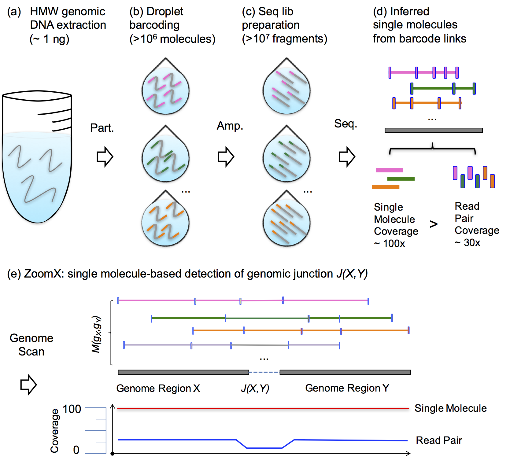
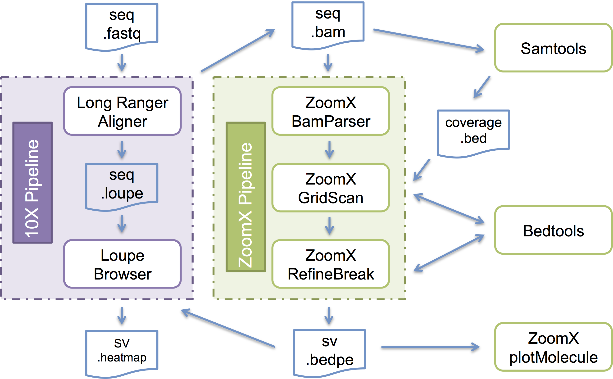

|Logo| ZoomX - Single Molecule Based Rearrangement Analysis with Linked Read Sequencing
==========================================================================================

QUICK LINKS
-----------

`Examples <doc/Example.master.rst>`__

`Manuals <doc/Manual.master.rst>`__

`FAQ <doc/FAQ.rst>`__

INTRODUCTION
------------
    
  ZoomX (Single Molecule Based Rearrangement Analysis with Linked Read Sequencing)

  - ZoomX analyzes single molecule whole genome sequencing data sets to identify long-range rearrangements.

  - ZoomX currently supports linked read sequencing data from 10X Genomics Chromium preparation.

  - ZoomX takes as input the BAM file output of LongRanger aligner and outputs a list of genomic junction sites in BEDPE format.

  - ZoomX's modeling and pipeline are illustrated in Figures 1 and 2.

  Figure 1. The principle and workflow of ZoomX.

  |Rationale|

  Figure 2. The bioinformatics pipeline of ZoomX.
  
  |Pipeline|
    
  Currently the package works for Linux (tested with Ubuntu). 
  It might also work for Mac with Brew/Ports or Windows with Cygwin (not tested).
  ZoomX documentation is available in the ``doc/`` folder of this repository
  (doc/Home.rst, doc/Example.master.rst, doc/Manual.master.rst and doc/FAQ.rst).

TRYOUT
------------

  An AWS EC2 instance and a preconfigured virtual machine are available for trying out ZoomX without installation efforts.

  *AWS EC2 VirtualMachine*:

    The Amazon Machine Image (ami) of the above EC2 instance is downloadable from Amazon S3 bucket.
    https://s3-us-west-2.amazonaws.com/lixiabucket/zoomxDemo.ova . The usage is the same as above.

    Testing data and scripts are available in ~/setup/zoomx/test . Run ./clean to clean up the directory first. Examples are offered and explained in `Examples <doc/Example.master.rst>`__ .

    .. code::
   
      cd  ~/setup/zoomx/test 
      ./clean
      ../scripts/zoomxStage germline10.cfg # germline test, see more notes inline within this bash script
      ../scripts/zoomxStage somatic10.cfg  # somatic test, see more notes inline within this bash script

DOCKER (Platform Independent and Preferred)
--------------------------------------------

  Due to the multiple R and Python dependencies involved,
  the easiest way to use ZOOMX is by the provided docker image or build file.
  
  A Docker image is available at DockerHub:
  
  ::
  
    docker pull charade/xlibbox:zoomx
  

  A Dockerfile is also provided to build ZOOMX enabled docker image from a standard Ubuntu docker image.

  If you are not familiar with Docker, it is a container platform widely used in industry/academia.
  Here is the link to learn Docker and its community: https://www.docker.com 

  If you have a docker server up and running, just use the Dockerfile from the repository root
  (`Dockerfile <Dockerfile>`__), copy it to . and run:

  ::

    docker build -t charade/xlibbox:zoomx --no-cache .

INSTALL (Linux/Ubuntu)
-----------------------------
  
  ZoomX is available on GitHub: https://github.com/labxscut/zoomx.git

  *Dependencies*:

    Python2(>=2.7)  http://www.python.org/

      pybedtools, pysam, pandas, tables, scipy

    R(>=3.3)  http://r-project.org
      
      CRAN: optparse, rjson, RColorBrewer, cowplot, igraph, ggplot2
 
      Bioconductor: IRanges, GenomicRanges, ggbio, GenomeInfoDb, BSgenome.Hsapiens.UCSC.hg38, BSgenome.Hsapiens.UCSC.hg19

    Samtools (>0.1.19) http://samtools.org
      samtools executables have to be in $PATH and within the sve_py virtual env
      NOTE: this is independent of the samtools api comes with Pysam. 
      
    Bedtools (>2.20.0) http://bedtools.org
      bedtools executables have to be in $PATH and within the sve_py virtual env

    To cope with their rare command interface change, working versions of Samtools and Bedtools are also provided with ZoomX. 
   
    A script to confirm all dependencies are met is here:

      `test/test_dep.sh <test/test_dep.sh>`__
    
  *Installation Free*:

    ZoomX can be used without installation as long as required commands in proper versions are all in $PATH.
    see `Examples <doc/Example.master.rst>`__ and `Manuals <doc/Manual.master.rst>`__ for more informations

  *Installation Python / Virtual Python*
    
    You can install ZoomX as a standard package to your site python without virtualenv, in particular when all python dependencies are already met. If you take this approach, please adapt following virtualenv based installation to your need.

    The other option is to use virtualenv based non-root installation, which separates zoomx from site python. virtualenv command is standard with Python 2.7 or later. see: http://python-guide-pt-br.readthedocs.io/en/latest/dev/virtualenvs/. If it is not present, please see https://virtualenv.pypa.io for details to install virtualenv for your python. Possibly as simple as:
    
    .. code::

      sudo easy_install pip
      sudo pip install virtualenv

    Ask your IT manager to help install it for you if you have permission difficulties.
    When your system python has virtualenv, make sure your $PYTHONPATH is set to empty. 
    Follow steps below:
    
    .. code::
      
      sudo pip install --upgrade pip
      virtualenv zoomx_vpy

    Now you can activate this virtual python for installing ZoomX python dependencies:
    
    .. code::
      
      # in zoomx_vpy>
      source zoomx_vpy/bin/activate 
      pip install scipy
      pip install tables
      pip install pandas
      pip install pysam
      pip install pybedtools

    Then install zoomx as an standard python package:
    
    .. code::

      # in zoomx_vpy>
      git clone https://github.com/labxscut/zoomx.git
      cd zoomx
      git submodule update --init --recursive 
      python setup.py install 

    Now the ZoomX executables will be available from "$PWD/zoomx_vpy/bin". 
    Because you installed ZoomX via virtualenv, remember to activate the virtualenv every time you use ZoomX. 
    Also export the environmental variable $ZOOMX_BIN=$PWD/zoomx_vpy/bin and add it to your $PATH

EXECUTABLES      
-----------

  zoomxStage    --  a meta script to run zoomxRun with multiple specified stages.

  zoomxRun      --  an interface script runs ZoomX's stage scripts given a configure file. see `Examples <doc/Example.master.rst>`__ .   

  parse10x      --  parsing 10X genomics (Chromium) bam. X.bam.bai has to be in place for X.bam.
    
  gridScan      --  scalable Poisson grid whole genome scan 
    
  refineBreak   --  refine and report junction candidates 

  filterMolecule.R -- filter molecules based on coverage (requires R>3.3 and optparse, IRanges, GenomicRanges from CRAN and BioConductor)

  plotMolecule.R  --  plot molecules supporting a junction (requires R>3.3 and optparse, rjson, ggplot2, RColorBrewer, GenomicRanges, ggbio from CRAN and BioConductor)

  getMolecule.sh  --  output molecules supporting a junction 
 
  bedpe2loupe.sh  --  convert bedpe coordinates to loupe coordinates for visualization 

USAGE
------------
    
  By default all above executables will be available from $ZOOMX_BIN/ .
  Use '-h' to read script-wise usage.
  See the manuals and examples under doc/ for more details.

WIKI
-------------

  ZoomX's manuals, FAQs and other documentation are maintained in the ``doc/`` folder of this repository (see `doc/Manual.master.rst <doc/Manual.master.rst>`__, `doc/Example.master.rst <doc/Example.master.rst>`__ and `doc/FAQ.rst <doc/FAQ.rst>`__). This is a MUST read before you actually use the ZoomX tool. Contributions to this documentation are welcome.
    
FAQ
-------------

  `doc/FAQ.rst <doc/FAQ.rst>`__
    
BUG
-------------

  https://github.com/labxscut/zoomx/issues

CONTACTS
-------------

  Questions and comments shall be addressed to lixia at stanford dot edu.

CITATIONS
---------

  1. Xia, Li Charlie; Bell, John; Wood-Bouwens, Christina; Chen, Jiamin; Zhang, Nancy; Ji, Hanlee. Identification of large rearrangements in cancer genomes with barcode linked reads. Nucleic Acids Research (2018) 46(4) e19 (https://doi.org/10.1093/nar/gkx1193)
